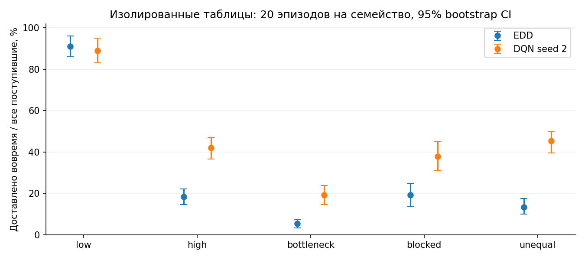
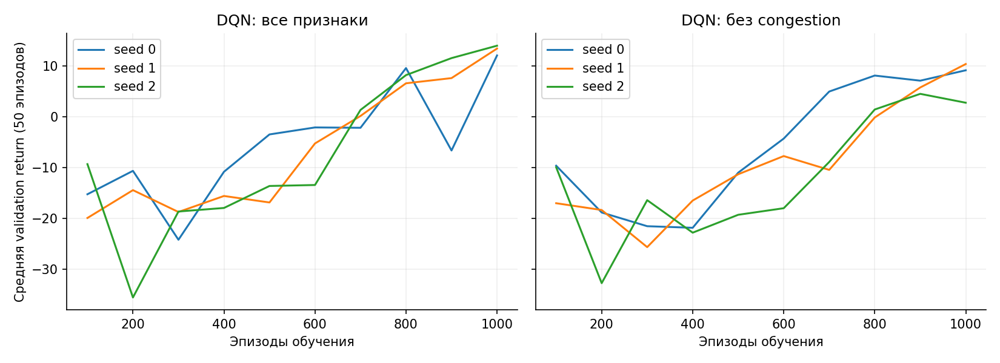

# G5: диспетчеризация EDD и DQN, изолированное сравнение

Дата: 23 ноября 2026. Реализация: ветка `g5/mission-dispatch`.
База разработки: `cf882fe96de686dbf73cda645f2aa4e93178be52`; обучение и приведённые
прогоны выполнены на рабочем дереве с изменениями. Это явно записано в manifests,
а SHA256 моделей и сценариев позволяют идентифицировать использованные входы.
Этот документ описывает выполненный эксперимент G5. Он не является общим отчётом
по роботам C0–C6 и не доказывает перенос результатов в Webots.

## Задача, гипотеза и границы

Исследуется выбор следующей заявки одним роботом при ограниченных сроках доставки.
Фиксированный диспетчер A выбирает Earliest Due Date (EDD), обучаемый диспетчер B —
действие DQN. Проверяемая гипотеза: учёт длительности поездок и состояния очереди
позволяет повысить долю своевременных доставок при высокой нагрузке. Улучшение
не обязано сохраняться при низкой нагрузке или новых ошибках навигации.

Основной показатель — число доставленных не позже deadline, делённое на **все
поступившие заявки**, включая неудачные и незавершённые. В каждом эпизоде считается
одна доля, затем усредняются эпизоды. Дополнительно сохраняются deliveries/hour,
задержки завершённых доставок, число и возраст незавершённых, расстояние, простой,
recovery, fallback и задержка принятия решения. Reward DQN не является итоговым
показателем качества доставки.

DQN не управляет скоростями робота, не подменяет планировщик пути и не изменяет
активную доставку. В ROS обе политики используют одно дерево поведения и одни
клиенты `ComputePathToPose`/`FollowPath`. Разработка G5 отделена от реализации
G1–G4; тестовые серверы навигации проверяют интерфейсы G5, а не качество чужих
алгоритмов. Требования взяты из [задания G5](../projects/05_mission.md),
[контрактов](INTERFACES.md) и [протокола экспериментов](EXPERIMENTS.md).

## Постановка A/B

Заявка содержит идентификатор, станции pickup/dropoff, момент поступления,
deadline и длительности обслуживания. Состояния `unreleased`, `released`,
`active`, `picked`, `delivered`, `failed` отделены от состояния ROS action.
Расписание известно загрузчику сценария, но политика видит только поступившие
заявки. Из очереди выбираются четыре старейшие по `(release_time, job_id)`.
Остальные сохраняются и попадают в метрики: удаление неудобных заявок запрещено.

Метод A минимизирует лексикографическую тройку
`(due_time, estimated_route_length, job_id)` среди тех же четырёх кандидатов.
Классический метод не имеет обучаемых параметров или отдельного test tuning.
В табличном эксперименте длина маршрута равна сумме базовых времён двух участков,
умноженной на номинальную скорость 0.5 м/с. Загруженность влияет на время поездки,
но не превращает длину маршрута в другое правило разрешения равных deadlines.

Метод B оценивает пять действий: выбрать слот 0–3 или ждать одну секунду
simulation time. Пустые слоты маскируются. Выбор новой заявки разрешён только
без активной доставки и груза. Маска применяется при случайном exploration,
вычислении Bellman target и C++ inference. Нечисловой результат/ошибка загрузки
модели приводит к EDD с журналированием fallback.

Используется DQN с replay buffer и отдельной target network; исходный подход
указан среди [технических первоисточников проекта](REFERENCES.md).
Собственная реализация включает среду диспетчеризации, контракт признаков,
обучение NumPy, экспорт и C++ вычисление MLP; готовый планировщик заданий не
используется. BehaviorTree.CPP реализует исполнение XML дерева, ROS 2 — обмен
actions, yaml-cpp — чтение сценариев и весов.

## Признаки и обучение

Сеть `32 → 64 ReLU → 5` содержит 2437 параметров. Семь признаков каждого кандидата:
время до pickup /120, время pickup→dropoff /120, slack /300, возраст заявки /300,
congestion участка доставки /3, накопленные неуспешные попытки навигации /2,
наличие кандидата. Slack вычитает оба travel time и оба service time. Последние
четыре признака: координаты робота /20, наличие груза и simulation time /300.
Нормировки фиксированы заранее и не оцениваются по test.

Bellman target имеет вид `r + (0.995 ** Δt) max_valid Q_target(s', a')`;
для конечного перехода вторая часть равна нулю. Discount зависит от времени,
поскольку доставка и ожидание имеют разную длительность. Huber loss ограничивает
влияние большого остатка TD; Adam с `lr=0.001` обновляет веса каждые два перехода.
Буфер содержит до 20 000 переходов, batch 64, обучение начинается после 128
переходов, target копируется каждые 250. Epsilon линейно уменьшается от 1 до 0.05
за первые 75% эпизодов. Градиент ограничивается покомпонентно до ±5.

Reward: доставка +5, своевременная доставка дополнительно +3, просрочка снижает
reward до −3, отказ −5; цена времени −0.01/с и решения −0.02. Ожидание при наличии
кандидатов дополнительно −0.05; незавершённая заявка при конце эпизода −2.
Такой reward поощряет завершение и сроки, но не гарантирует их оптимизацию:
случай чрезмерного ожидания ниже показывает реальное ограничение.

| Training seed | Эпизоды | Переходы | Обновления весов | Лучший validation return | Время обучения, с |
|---|---:|---:|---:|---:|---:|
| 0 | 1000 | 33974 | 16923 | 12.031 | 13.02 |
| 1 | 1000 | 32036 | 15954 | 13.387 | 13.94 |
| 2 | 1000 | 34157 | 17015 | 13.950 | 14.31 |

Каждые 100 эпизодов checkpoint проверялся на 50 фиксированных validation
эпизодах. Для каждого seed сохранялся лучший checkpoint, а для ROS deployment
выбран seed 2 по максимальному validation return. Test при выборе не использован.
Отдельно выполнены три обучения без явного congestion feature с теми же budgets.
Их лучшие validation returns: 9.112, 10.343, 4.475; выбран seed 1.

Обучение CPU, NumPy 1.26.4, `OPENBLAS_NUM_THREADS=1`, `OMP_NUM_THREADS=1`.
Повторное полное обучение seed 2 дало побитно одинаковый checkpoint:
`b86f66590da3591a8d1ec96cdd113b627e1a69c4dc9b2f39132acf081ea16cb3`.
Это не обещание одинакового времени или округления на другом BLAS/CPU.
Кривые каждого seed сохранены как `learning*.csv`, полная карточка —
[model_card.json](../ros2_ws/src/capstone_mission/models/model_card.json).

## Таблицы и протокол

Данные генерируются независимо по layout и scenario seed. Используются три
train layouts, один validation и два test layouts. Train seeds 0–999;
validation оценка 1000–1009; test 2000–2019. Матрицы геометрии/объездов test
не используются при обучении. [Manifest сценариев](../ml/mission/scenarios/manifest.json)
содержит хеши файлов; генератор воспроизводит полный train-диапазон, а 15 train
файлов в Git — компактные примеры, не весь набор обучающих переходов.

Каждый склад содержит шесть станций. Базовое время получается из расстояния
с учётом постоянного объезда и скорости 0.5 м/с. Congestion — фиксированный для
эпизода множитель. Горизонт 300 с, arrivals до 170 с, обслуживание 2 с в каждой
точке. Низкая нагрузка содержит 5 заявок, остальные семейства — 12.

| Семейство | Воздействие |
|---|---|
| low | Низкая интенсивность, congestion 1 |
| high | Высокая интенсивность, congestion 1–1.6 |
| bottleneck | Дополнительный множитель 2.5 между двумя группами станций |
| blocked | Одна пара станций недоступна, остальные поездки как high |
| unequal | Чередование короткого и длинного окна deadline |

На заблокированном этапе выполняются две попытки по секунде. Отказ до pickup
оставляет робота свободным; отказ после pickup удерживает груз и запрещает новую
заявку до конца горизонта. Все arrivals этого горизонта продолжают учитываться.
Поездка, не успевшая закончиться, даёт только фактически пройденную часть
расстояния. При нуле доставок distance/job и tardiness — `NA`.

C++ `dispatch_benchmark` использует тот же `JobQueue`, EDD, observation и DQN,
что ROS-узел, но выполняет поездки по таблицам. Проверены 7 вариантов
(EDD + 3 DQN + 3 ablation) × 5 семейств × 20 эпизодов = **700 изолированных
эпизодов**. Это отдельная серия G5, а не требуемые общие 560 запусков C0–C6.
Каждый метод получает одинаковые сценарии. Модели фиксированы до test, результат
не дообучает сеть. Все неуспехи сохраняются.

Исходные артефакты серии: [metrics.csv](../experiments/g5/isolated-v1/metrics.csv),
[events.csv](../experiments/g5/isolated-v1/events.csv),
[summary.csv](../experiments/g5/isolated-v1/summary.csv),
[summary_all_metrics.csv](../experiments/g5/isolated-v1/summary_all_metrics.csv),
[manifest.yaml](../experiments/g5/isolated-v1/manifest.yaml). Сценарии доступны
в `ml/mission/scenarios/test`, их hashes совпадают с manifest серии.

Единица статистики — эпизод. C++ агрегатор проверяет дубли, число 20,
пять семейств и совпадение episode IDs методов. Доверительные интервалы среднего
и парных различий получены bootstrap по эпизодам: 10 000 выборок, analysis seed
2026. Seeds обучения показываются отдельно; 60 эпизодов разных обученных моделей
не трактуются как 60 независимых обучений. Интервалы описывают заданные две
test-планировки. Утверждения о статистической значимости множества сравнений
без поправки не делаются.

## Результаты





Графики строятся `MPLCONFIGDIR=/tmp/g5-matplotlib python3 scripts/plot_g5_results.py`
из готовой C++ сводки и журналов обучения (требуется Matplotlib).
Исходные SVG сохранены рядом с PNG; Python здесь не рассчитывает test-метрики.

Ниже показан выбранный по validation DQN seed 2. Значения — проценты своевременных
доставок; различия — процентные пункты. На строку приходится 20 эпизодов метода.

| Сценарий | EDD, среднее [95% CI] | DQN seed 2, среднее [95% CI] | Парная разность DQN−EDD [95% CI], п.п. |
|---|---|---|---|
| low | 91.00 [86.00; 96.00] | 89.00 [83.00; 95.00] | −2.00 [−7.00; 3.00] |
| high | 18.33 [14.58; 22.08] | 42.08 [36.67; 47.08] | 23.75 [19.58; 27.92] |
| bottleneck | 5.42 [3.33; 7.50] | 19.17 [14.58; 23.75] | 13.75 [10.00; 17.50] |
| blocked | 19.17 [13.75; 25.00] | 37.92 [31.25; 45.00] | 18.75 [12.08; 25.00] |
| unequal | 13.33 [10.00; 17.50] | 45.42 [39.58; 50.00] | 32.08 [27.08; 36.25] |

На этой табличной выборке DQN повышает основной показатель в четырёх нагруженных
семействах. При низкой нагрузке EDD имеет большее среднее, а парный интервал
включает ноль. Следовательно, утверждение «обучаемый метод всегда лучше»
не поддерживается. Даже при росте on-time fraction многие эпизоды завершаются
с незавершёнными заявками; метрика не означает успешность всей миссии.

Дополнительные показатели (средние по 20 эпизодам; интервалы — 95% CI):

| Сценарий | Доставки/час EDD | Доставки/час DQN 2 | Незавершённые EDD | Незавершённые DQN 2 |
|---|---|---|---|---|
| low | 81.36 [76.98; 86.02] | 81.39 [73.68; 88.03] | 0 [0; 0] | 0.15 [0; 0.40] |
| high | 74.40 [67.80; 81.60] | 88.20 [80.40; 95.40] | 5.80 [5.20; 6.35] | 4.65 [4.05; 5.30] |
| bottleneck | 37.80 [31.80; 43.80] | 49.80 [43.20; 55.80] | 8.85 [8.35; 9.35] | 7.85 [7.35; 8.40] |
| blocked | 69.00 [59.40; 77.40] | 76.20 [63.60; 87.60] | 6.25 [5.55; 7.05] | 5.65 [4.70; 6.70] |
| unequal | 91.80 [84.00; 99.60] | 102.60 [93.60; 110.40] | 4.35 [3.70; 5.00] | 3.45 [2.80; 4.20] |

Для выбранной модели fallback равен нулю во всех 100 test-эпизодах: наблюдаемые
решения получены сетью. DQN увеличивает простой; например, в bottleneck он равен
79.28 с против 0.05 с у EDD. Поэтому снижение средней просрочки завершённых задач
нельзя рассматривать отдельно от количества завершённых и unfinished.

Все training seeds, а не только выбранный:

| Семейство | DQN 0 | DQN 1 | DQN 2 | Без congestion 0 | Без congestion 1 | Без congestion 2 |
|---|---:|---:|---:|---:|---:|---:|
| low | 87.00 | 84.00 | 89.00 | 84.00 | 84.00 | 81.00 |
| high | 36.25 | 37.50 | 42.08 | 38.33 | 36.25 | 35.42 |
| bottleneck | 17.50 | 20.00 | 19.17 | 20.00 | 20.00 | 16.25 |
| blocked | 25.42 | 29.17 | 37.92 | 32.50 | 32.50 | 30.42 |
| unequal | 44.58 | 43.33 | 45.42 | 40.83 | 40.00 | 41.25 |

Ablation зануляет только явный congestion feature при обучении и inference;
travel times всё ещё отражают загруженность. Поэтому она проверяет пользу
дополнительного признака, а не удаление всей информации о заторах. Результаты
не показывают монотонного улучшения для всех seeds: например, bottleneck у полной
модели seed 2 ниже, чем у ablation seed 1. Разброс между seeds особенно заметен
в blocked. Три обучения ограничивают точность вывода о training variance.

## Три разобранных неуспеха

Примеры выбраны после оценки для объяснения ошибок, не для выбора модели.
Значения взяты из C++ `metrics.csv` и `events.csv` серии `isolated-v1`.

1. **Чрезмерное ожидание, `test_blocked_2010`, seed 2.** DQN завершает две
   заявки к 61.8214 с, после чего многократно выбирает `wait` до конца 300 с.
   Общий простой 243.1786 с; доставлено 2 из 12, обе вовремя, осталось 10.
   EDD в том же эпизоде доставляет 9, из них 4 вовремя, простой 5 с.
   В журнале нет navigation failure: это ошибка выбора политики, а не потеря
   пути. Нулевая tardiness DQN здесь обманчива без числа unfinished: она относится
   лишь к двум завершённым заявкам. Возможное направление исправления — изменить
   reward/представление ожидания на train/validation; test для настройки не использован.

2. **Недоступная доставка после pickup, `test_blocked_2006`, seed 2.** После
   двух успешных доставок выбрана `job_003` в 87.9108 с. Pickup завершён в
   89.9108 с, две попытки пройти к `s4` закончились в 91.9108 с событием
   `dropoff_no_path_loaded`. Робот больше не выбирает заявки: один failure,
   одна recovery, 2 доставленных, 10 unfinished. EDD также встречает отказ,
   но успевает доставить 4, из них 2 вовремя. DQN не может устранить отсутствие
   маршрута; этот случай проверяет удержание груза и честный учёт заявок.

3. **Неудачный порядок при низкой нагрузке, `test_low_2011`, seed 2.** Все
   пять заявок завершены, но `job_002` отложена до конца: порядок
   `000 → 003 → 004 → 001 → 002`. Её доставка заканчивается в 176.2864 с,
   просрочка 61.1136 с. Получены 4/5 доставок вовремя, mean tardiness 12.2227 с;
   EDD завершает 5/5 вовремя. Простоя и отказов нет. Это компромисс обученной
   оценки порядка, который не исправляется быстрым inference или safety monitor.

## Исполнение и проверки

Веса экспортируются как JSON MLP: row-major матрицы `[64,32]` и `[5,64]`,
два вектора смещений. Это не ONNX, а открытый фиксированный формат для двух
матричных умножений C++ и ReLU. На роботе не нужен Python/NumPy. Runtime проверяет
формат, размеры и конечность чисел; ошибочная модель вызывает явный fallback.

Эталон `golden.json` сверяет Q-значения и действия C++/Python. Отдельный
`preprocessing_golden.json` содержит сырые сценарии и контекст: проверяются
travel estimates, порядок кандидатов, slack, overflow очереди, пустая очередь,
loaded mask, накопленные failures и ablation. Допуски: 1e−4 для Q, 1e−6 для
признаков. Python tests проверяют скрытие future arrivals, очередь, wait,
недопустимые действия, bounded failures, изменение весов при обучении,
экспорт и маскирование Bellman target. Проверены 13 tests и `ament_flake8`.
Статус ROS action-тестов приводится в общем отчёте реализации, поскольку
табличная серия не проверяет cancellation/stop handshake.

Алгоритмическая стоимость inference — около 2368 multiply-add плюс ReLU;
сканирование очереди и выделение четырёх старейших кандидатов в текущей
реализации включает сортировку ожидающих заявок. Измеренная C++ decision latency
сохраняется в каждой строке metrics и зависит от машины. Это не end-to-end
ROS latency. Потребление памяти процесса и поведение в Webots в этой серии
не измерялись, поэтому numerical claims по ним не приводятся.

## Воспроизведение и остающаяся интеграция

Дополнительно выполнен ROS-стенд с кинематическим тестовым сервером навигации.
Артефакты находятся в [experiments/g5/ros-demo](../experiments/g5/ros-demo):
отдельные процессы миссии, сервера actions и runner, реальные callbacks,
simulation clock, odometry, event ledger и итоговые метрики C++.
Классическая и обучаемая миссии завершают обе заявки вовремя; измеренное
расстояние в обоих случаях 3.4142 м. Табличное исполнение того же небольшого
сценария также завершает 2/2 заявки и даёт 3.4142 м, длительность 8.8284 с.
Время ROS-эпизодов записано в соответствующих `metrics.csv`; оно отличается
из-за скорости тестового сервера 1 м/с против оценки 0.5 м/с и задержек
action/timer обмена. Это проверка согласованности журналирования и пример
разрыва между оценкой времени и исполнением, а не измерение domain gap Webots.

В том же стенде воспроизведены blocked route, controller failure и остановка
`/clock` во время активной навигации. Неуспехи заканчиваются ненулевым exit code
и сохраняют причины в `episode.yaml`/`events.csv`; они не добавлены в статистику
100 test-сценариев. C++ пересчёт ledger проверяет episode ID, последовательность
`released → selected → picked → delivered/failed`, невозможность перекрывающихся
доставок и выбора после отказа с грузом, конечность и порядок времени. 16 CLI
тестов включают повреждённые журналы и пять записанных ROS-прогонов. Эти проверки
не оценивают столкновения, безопасность Webots или алгоритмы G1–G4.

Обучение и экспорт полностью описаны в [README обучения](../ml/mission/README.md).
Для повторения C++ оценки после `make build PKG=capstone_benchmark` открыть
`make shell` и выполнить (каталог результата должен быть новым):

```bash
ros2 run capstone_benchmark dispatch_benchmark \
  --scenarios /workspace/ml/mission/scenarios/test \
  --output /workspace/results/g5/reproduction \
  --model seed0=/workspace/ros2_ws/src/capstone_mission/models/dqn_seed_0.json \
  --model seed1=/workspace/ros2_ws/src/capstone_mission/models/dqn_seed_1.json \
  --model seed2=/workspace/ros2_ws/src/capstone_mission/models/dqn_seed_2.json \
  --ablation ablation0=/workspace/ros2_ws/src/capstone_mission/models/dqn_no_congestion_seed_0.json \
  --ablation ablation1=/workspace/ros2_ws/src/capstone_mission/models/dqn_no_congestion_seed_1.json \
  --ablation ablation2=/workspace/ros2_ws/src/capstone_mission/models/dqn_no_congestion_seed_2.json \
  --commit YOUR_EXACT_COMMIT
ros2 run capstone_benchmark aggregate_dispatch \
  /workspace/results/g5/reproduction/metrics.csv \
  /workspace/results/g5/reproduction/summary.csv
```

EDD включается автоматически. Не следует указывать чистый SHA, если код имеет
незафиксированные изменения: actual dirty state должен быть виден в provenance.
Проверка SHA256 перед сравнением защищает от случайной подмены модели/сценария.

Главное ограничение исследования — domain gap. Таблицы не моделируют ошибки
локализации, проскальзывание, задержки ROS, движущиеся препятствия и взаимодействие
с MPC/PPO. В закрытом контуре одинаковые заявки могут дать другие travel times,
а ошибка G3/G4 может привести к recovery и изменению порядка дальнейшей очереди.
Для оценки этого эффекта нужно подключить готовые G1–G4, запустить A/B с одним
сценарием и конфигурацией навигации, сохранить реальные времена и сравнить их
с таблицами. Тестовый сервер или упрощённая симуляция не заменяет эту проверку.

Общая серия C0–C6, 50 системных отказов, collision metrics, данные других групп,
их разделы интеграционного отчёта и личные записи вклада отсутствуют в данном
изолированном исследовании. Их нельзя выводить из 700 успешных запусков runner.
Текущие артефакты доказывают реализацию двух способов диспетчеризации, обучение,
C++ inference, воспроизводимость и измеренное сравнение на зафиксированных
таблицах; границы этих доказательств указаны явно.
