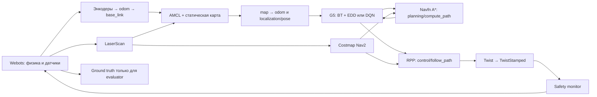

# Физический стенд G5 с базовой навигацией Nav2

Ветка `integration/g5-nav2-webots` добавляет проверку G5 в Webots R2025a.
Сценарий: дифференциальный робот перевозит две заявки между станциями по разные
стороны стеллажа. Прямая дорога перекрыта; путь должен обходить препятствие.

Это базовая интеграция G3/G4 для испытания G5. Глобальный планировщик — Navfn
с A*, локальный контроллер — Regulated Pure Pursuit. Они выбраны по работающему
профилю `/home/tim/ware_ws/src/waf_navigation/config/navigation.yaml`, с адаптацией
геометрии, TF и интерфейсов этого проекта. Это не реализация обученной карты
стоимости G3 и не MPC/PPO из задания G4. Существующий независимый safety monitor
работает в цепочке управления; ранее реализованные библиотеки G4 сохранены.

## Запуск без Docker

Проверяемая платформа: Ubuntu 24.04 x86_64, ROS 2 Jazzy, Nav2. Если ROS уже установлен,
но Nav2 отсутствует, нужны пакеты:

```bash
sudo apt install ros-jazzy-navigation2 ros-jazzy-nav2-bringup xauth
```

Из корня репозитория:

```bash
make g5-system-setup
make g5-system-build
make g5-system-test
make g5-system-test G5_METHOD=learned
make g5-system-test G5_SYSTEM_ARGS='--mode cancel'
make g5-system-test G5_SYSTEM_ARGS='--mode repeat'
```

Первая команда скачивает официальный архив Webots R2025a и проверяет SHA256.
Webots и, при необходимости, Xvfb распаковываются в `.cache/`; установка Docker
и изменение системных пакетов для этого не нужны. Для скачивания нужен интернет.
Если ROS 2 отсутствует, его нужно предварительно установить отдельно.

Для просмотра движения в окне:

```bash
make g5-system-test G5_SYSTEM_ARGS='--gui'
```

По умолчанию результаты попадают в новую папку `results/g5-system-ДАТА-ВРЕМЯ`.
Можно задать `--output results/my-run`; существующую папку команда не перезаписывает.
`--domain 185` изолирует ROS от других роботов; для параллельного запуска задайте
другой domain. Стенд использует собственный Xvfb в режиме без окна. Webots работает
в реальном времени, чтобы частота физики не обгоняла обработку Nav2.

Старый `make g5-demo` запускает отдельный отладочный стенд через Docker. Для физического
испытания используйте именно команды `g5-system-*` выше.

## Где что находится

| Путь | Назначение |
|---|---|
| `simulation/integration/warehouse.wbt` | Самодостаточный мир, физические колёса, энкодеры, лидар |
| `simulation/integration/map.yaml`, `map.pgm` | Статическая карта того же мира |
| `ros2_ws/src/capstone_webots_bridge` | C++ контроллер Webots: моторы, сенсоры, часы, reset |
| `ros2_ws/src/capstone_nav2` | Параметры и запуск AMCL/Nav2, адаптер интерфейсов |
| `ros2_ws/src/capstone_mission` | G5: BT, EDD/DQN, очередь, action-клиенты, журнал |
| `ros2_ws/src/capstone_safety` | Независимая проверка и остановка команд скорости |
| `ros2_ws/src/capstone_system_test` | Сценарий и C++ проверка физических результатов |
| `scripts/run_g5_system.py` | Запуск процессов, ожидание проверок, очистка после завершения |

## Поток данных



Одометрия интегрируется из вращения колёс. AMCL оценивает положение по лидару
и карте, начиная с известной стартовой точки сценария. Истинная поза Webots
публикуется только в `evaluation/ground_truth` и не используется навигацией.
Адаптер также строит простую локальную сетку препятствий из скана для контракта
готовности G5; это базовая замена входа G2, а не его ML-решение.

G5 сам управляет последовательностью «выбрать → доехать за грузом → загрузить →
доехать к получателю → разгрузить». Nav2 BT Navigator не запускается. Для каждой
поездки G5 вызывает `ComputePathToPose`, затем `FollowPath`, обрабатывает feedback,
ошибки и отмену. Только safety monitor публикует конечный `cmd_vel`.

AMCL обычно обновляет позу после движения. Чтобы G5 получал свежую локализацию
также на стоянке, адаптер запрашивает `request_nomotion_update`: AMCL обрабатывает
новый скан. Время старой позы не заменяется текущим временем.

## Что считается успешным испытанием

`episode_N/episode.yaml` фиксирует результат runner; `metrics.csv` — метрики G5.
Независимый `physical/audit.yaml` проверяет:

- реальное перемещение робота по данным физики Webots;
- план объезда стеллажа и отсутствие пересечения траекторией его габаритов;
- соответствие событий загрузки/доставки фактическим координатам станций;
- остановку по энкодерам и истинной позе после конечного статуса;
- при `--mode cancel` — отмену во время движения и физическую остановку;
- при `--mode repeat` — два эпизода в тех же процессах со сбросом часов и позы.

`physical/trajectory.csv` и `plans.csv` сохраняют исходные данные проверки,
`events.csv` — журнал BT. В `logs/` лежат раздельные логи Webots, bridge, Nav2,
миссии, runner и evaluator. `provenance.json` содержит выбранный метод, commit
и хеши ключевых артефактов. При неуспехе команда возвращает ненулевой код.

Reset восстанавливает физическое состояние робота и энкодерную одометрию.
ROS-время нового эпизода начинается заново через смещение часов Webots;
процесс симулятора остаётся жив. Адаптер восстанавливает начальную гипотезу AMCL
при скачке времени назад. Повторный эпизод начинается после подтверждённой
физической остановки предыдущего.

Веса DQN в этом изменении не переобучаются. Обучение и прежнее изолированное
сравнение описаны в [G5_METHOD_B.md](G5_METHOD_B.md). Несколько физических
эпизодов проверяют интеграцию, но не доказывают статистическое превосходство DQN
и не заменяют общую матрицу испытаний C0–C6 из README.

## Подтверждённые физические прогоны

25 ноября 2026 года на этом стенде завершены следующие испытания. Время —
симуляционное от начала эпизода до конечного статуса; расстояние измерено
по истинной позе Webots. Все перечисленные `physical/audit.yaml` имеют
`success: true`.

| Прогон | Доставлено | Конечный статус | Время, с | Физический путь, м |
|---|---:|---|---:|---:|
| [DQN, learned](../experiments/g5/webots-nav2/learned/physical/audit.yaml) | 2 из 2 | completed | 74.96 | 16.215 |
| [EDD, repeat: первый эпизод](../experiments/g5/webots-nav2/classical-repeat/physical/episode_1.yaml) | 2 из 2 | completed | 64.80 | 16.177 |
| [EDD, repeat: второй эпизод](../experiments/g5/webots-nav2/classical-repeat/physical/episode_2.yaml) | 2 из 2 | completed | 82.50 | 16.026 |
| [EDD, отмена в движении](../experiments/g5/webots-nav2/cancel/physical/audit.yaml) | 0 из 2 | cancelled | 5.10 | 1.040 |

В трёх завершённых эпизодах доставки все шесть заявок доставлены вовремя;
`metrics.csv` фиксируют ноль восстановлений (`recoveries`) и ноль переходов
на резервный диспетчер (`fallbacks`). Максимальная ошибка позиции при загрузке
или доставке составила 0.2603 м при допуске 0.35 м. Повторный запуск подтвердил
один сброс ROS-времени и два успешных эпизода в тех же процессах.

При отмене робот уже загрузил первую заявку и двигался к получателю.
От запроса отмены до подтверждённой остановки прошло 0.62 с симуляционного
времени, включая проверку неподвижности в течение не менее 0.3 с после
конечного статуса. Доставка в этом тесте намеренно не завершена.
В сохранённом запуске отмены `metrics.csv` отсутствует; результат подтверждают
`episode_1/episode.yaml`, журнал событий и физический аудит.

Во всех четырёх эпизодах зарегистрировано ноль физических контактов,
нет пересечения стеллажа траекторией корпуса и подтверждена конечная остановка.
Сохранены исходные траектории, планы, события, метрики при наличии, сценарий,
`provenance.json` и журналы процессов. Графики построены из этих данных:
[learned](../experiments/g5/webots-nav2/learned/trajectory.png),
[classical-repeat](../experiments/g5/webots-nav2/classical-repeat/trajectory.png),
[cancel](../experiments/g5/webots-nav2/cancel/trajectory.png).
В каждой папке `artifacts.sha256` позволяет проверить целостность командой
`sha256sum -c artifacts.sha256`, запущенной из этой папки.

Эти результаты подтверждают конкретные сценарии доставки, повторного запуска
и отмены. Разница времён между отдельными эпизодами не является сравнительной
оценкой качества EDD и DQN. Каталоги `development-*` сохраняют историю
диагностических запусков и не включены в приведённые успешные результаты.

## Отдельная проверка физического драйвера

До запуска Nav2 можно проверить сам Webots-мост:

```bash
scripts/run_bridge_probe.sh results/bridge-probe 186
```

Скрипт использует отдельный ROS_DOMAIN_ID без Nav2/safety monitor, подаёт фиксированную
тестовую скорость и проверяет настоящие LiDAR/энкодеры, физическое смещение, остановку
watchdog и reset. Это не тест автономной доставки. Сохранённый
[аудит](../experiments/g5/webots-nav2/bridge-probe/audit.json) содержит SHA256 мира,
исходников и проверенных бинарных файлов; [лог](../experiments/g5/webots-nav2/bridge-probe/probe.log)
фиксирует физическое смещение 0.855997 м и энкодерное 0.855882 м, отсутствие контактов
и скорость корпуса после watchdog −0.000004 м/с.

Поза runtime вычисляется из энкодеров. Ground truth Supervisor читается только для
`/evaluation/ground_truth`; Nav2/G5 на этот топик не подписываются. Reset не завершает
Webots: восстанавливает физическое состояние робота и запускает новый отсчёт
`/clock = WebotsTime − epoch`. Ответ `/simulation/reset` приходит после физического
шага и публикации новых часов/одометрии. AMCL/Nav2/G5 сбрасываются оркестратором отдельно.
