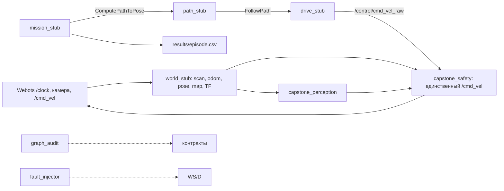

# Интеграционный отчёт: стенд `capstone_integration`

Сокращения раскрыты при первом употреблении; [полный словарь](../GLOSSARY.md).

Черновик. Автор: Волков Андрей (GitHub `buigbvns`), интеграционная роль вне G1–G5.
Ветка `integration/skeleton`, release tag не выставлен. Дата: 24.11.2026.
Артефакты: [`ros2_ws/src/capstone_integration`](../../ros2_ws/src/capstone_integration),
[ADR 0005](../adr/0005-integration-harness.md),
[запись вклада](../contributions/volkov.md). Отчёт о подпроекте (25 баллов) не входит в эту работу:
студент не состоит ни в одной из групп G1–G5.

## 1. Задача, исследовательский вопрос и гипотеза

Задание требует одного интегрированного робота и сравнительной серии C0…C6. Группы поставляют
компоненты независимо, а сквозная проверка стыков по плану начинается только на 9–10-й неделе.
Вопрос этой работы:

> Можно ли собрать контракт v1 в работающую цепочку и получать воспроизводимые метрики до
> готовности всех групп, и какие дефекты стыков при этом обнаруживаются?

Гипотеза до экспериментов: большинство дефектов интеграции проявляется не в алгоритмах, а в
несовпадении контрактов (тип, frame, частота, число publisher'ов, время, action-семантика) и в
отсутствии проверяемого reset/readiness. Primary metric для этой работы — не качество движения, а
**доля контрактов, проверенных автоматически**, и **воспроизводимость эпизода** (повторный запуск
даёт тот же terminal reason и сопоставимые метрики).

## 2. Связь с курсом и собственный вклад

Использованы: ROS 2 Jazzy, Webots R2025a, C++17, `nav2_msgs` actions (`ComputePathToPose`,
`FollowPath`), TF2, Docker. Собственный вклад:

- пакет `capstone_integration`: временные узлы на месте отсутствующих компонентов;
- аудит контрактов живого графа (`graph_audit`) с JSON и кодом возврата для CI;
- серия эпизодов с reset, манифестом и аудитом внутри эпизода;
- C++ агрегатор с интервалом Уилсона и p95;
- стенд отказов с замером задержки остановки;
- запрет измеряемых прогонов при активных заглушках.

## 3. Постановка

Контракты — [INTERFACES.md](../INTERFACES.md). Эпизод: до 300 с симуляции, 6 заявок с моментами
появления `[0, 20, 50, 80, 120, 160]` с и сроком 120 с после появления, вместимость 1,
погрузка/разгрузка — остановка 2 с. Сценарий стенда — S1 (статический склад), одна планировка.

Terminal reasons: `SUCCESS` (все заявки доставлены), `TIMEOUT` (лимит эпизода), `ABORTED`
(отказ планирования/следования), `COLLISION` (пока не детектируется стендом).

## 4. Реализация



Пакет: `include/`, `src/`, `config/`, `launch/`, `tools/`, `test/`. Чистая логика (кинематика,
построение пути, CSV, аудит, агрегация, манифест заявок) отделена от ROS и покрыта gtest —
**60 тестов** на текущем коммите.

Временные узлы помечены `PLACEHOLDER` в логе и в CSV (`placeholder_components`). Замена на узел
группы — удаление одного `Node(...)` из `launch/system.launch.py`.

## 5. Данные и обучение

Обучение не выполнялось: стенд не содержит обучаемых методов. Seed симулятора и training seed в
CSV пока фиксированы значениями `0` и `none`; формат полей соответствует минимальной схеме
[EXPERIMENTS.md](../EXPERIMENTS.md). Для итоговой серии нужны `train_*`/`val_*`/`test_*` layouts —
это часть работы G1/G2/G3.

## 6. Протокол

- Один эпизод — один контейнер стека, перед ним перезапуск контейнера симулятора (свежий мир).
- Аудит запускается через 12 с после старта, пока робот движется; окно 5 с.
- Каждый эпизод даёт `episode.csv`, `audit.json`, `manifest.json`; сводка — `series_audit.csv`.
- `measured_run=true` запрещает заглушки: аудит FAIL, эпизод помечается `INVALID`, скрипт
  возвращает 1.
- Агрегатор: группировка по `config_id` + `scenario_id`, интервал Уилсона 95 %, mean и p95.

## 7. Результаты (стенд, не системные результаты)

Шесть заявок, S1, один эпизод (ветка `integration/skeleton`):

| Показатель | Значение |
|---|---|
| terminal reason | `SUCCESS` |
| доставлено / выпущено | 6 / 6 |
| доставлено вовремя | 6 / 6 |
| время эпизода | 195.6 с |
| путь | 74.9 м |
| столкновения | не детектируются стендом |
| задержка решения планировщика | 1 мс (заглушка) |

Более ранняя серия из семи эпизодов с одной заявкой: 7/7 успешно, mean 17.98 с, p95 18.60 с,
Wilson 95 % CI для доли успеха `0.65…1.00`.

Аудит во время движения (эпизод `series-1`):

```text
/clock                       OK
/sensors/imu                 FAIL   0 publisher(s), expected >= 1
/sensors/scan                OK     10.0 Hz, frame base_link
/state/odom                  OK     50.0 Hz, frame odom
/localization/pose           OK     10.0 Hz, frame map
/cmd_vel                     OK     20.2 Hz, frame base_link, ровно 1 publisher
TF map->base_link            OK
/planning/compute_path       OK     action server present
/control/follow_path         OK     action server present
ground_truth_leak            OK
placeholders                 WARN   world_stub, path_stub, drive_stub, mission_stub
```

Отказы (свежий мир на каждый прогон, один повтор):

| Отказ | Остановка, с | Диагностика, с | Причина | Восстановление |
|---|---:|---:|---|---|
| пропадание датчика | 0.347 | 0.326 | `STALE_SCAN` | да |
| устаревшая команда | 0.203 | 0.163 | `STALE_CMD` | да |
| падение контроллера | 0.153 | 0.132 | `STALE_CMD` | нет (ожидаемо) |

Битая модель (вручную): узел G2 не падает, пишет `using the classical fallback` на каждый кадр.
Заморозка `/clock` (вручную, `docker pause`): `/cmd_vel` меняется с 0.50 на 0.0, `halt: STALE_CMD`,
после `unpause` работа продолжается.

**Эти числа не являются результатами C0…C6**: все пять компонентов частично заменены заглушками.

## 8. Разобранные случаи ошибок

1. **Замороженный `/clock` давал ложный успех.** Первый сквозной прогон «доехал» за 17.25 с,
   хотя симулятор стоял: dead reckoning интегрировал команды, а миссия не упиралась в таймаут.
   Обнаружено ручной проверкой `ros2 topic hz /clock`. Вывод: аудит обязан проверять продвижение
   `/clock`, иначе успех недостоверен.
2. **Восприятие отбрасывает кадры.** `/sensors/rgb` выдаёт 6.8 Гц вместо 10, метка времени
   отстаёт от `/clock`; `capstone_perception` пишет `invalid or stale RGB-D timestamp`. Следствие:
   `/perception/obstacles` тоже 6.8 Гц. Нужен разбор с G2 и владельцем sim-адаптера.
3. **Аудит после эпизода даёт ложный FAIL.** При запуске аудита после завершения миссии
   `/control/cmd_vel_raw` молчит (контроллер закончил), и проверка «нет сообщений» краснеет.
   Исправлено: аудит запускается во время движения. Это же показывает, что порядок проверок —
   часть контракта.

Дополнительно: ошибка `cd` в скрипте серии давала ложное предупреждение «нет episode.csv» при
успешном эпизоде; исправлено и перепроверено.

## 9. Интеграция и влияние на группы

Найдено и передано:

- **G1**: отсутствует `/sensors/imu`; нет ground truth, поэтому физическое прибытие проверяется
  только по собственной оценке; reset эпизода через supervisor отсутствует.
- **G2**: дрейф меток времени RGB-D относительно `/clock` (6.8 Гц, дропы кадров).
- **G4**: ROS-узел FollowPath и action-серверы отсутствуют, хотя алгоритмы готовы; PPO не влит в
  `main`.
- **G5**: на момент работы нет узла миссии и бенчмарка; стенд закрывает инфраструктуру, но не
  заменяет их методы.

Проверенные контракты: `/clock`, `/sensors/*`, `/state/odom`, `/localization/pose`, `/map`,
`/perception/obstacles`, `/planning/compute_path`, `/control/follow_path`, `/control/cmd_vel_raw`,
`/cmd_vel`, `/mission/status`, TF, отсутствие подписки runtime-узлов на ground truth, ровно один
publisher `/cmd_vel`.

## 10. Ограничения и воспроизведение

Ограничения: dead reckoning вместо EKF/ICP; пустой скан; прямая вместо A*; pure pursuit вместо
MPC/PPO; миссия без Behavior Tree, preemption и recovery; один робот; сброс — перезапуск
контейнера; 3 из 5 отказов автоматизированы; C6 невозможна без обученных узлов G1/G3/G5.

Воспроизведение из чистой копии:

```bash
git clone <repo> && cd autonomous-robotics-masters-capstone-cpp-ru
./scripts/setup_host.sh
make doctor && make smoke
make build PKG=capstone_integration && make test PKG=capstone_integration
make sim-gui                      # терминал 1
make shell                        # терминал 2
ros2 launch capstone_integration system.launch.py
ros2 run capstone_integration graph_audit --ros-args -p json_path:=/workspace/results/audit.json
ros2_ws/src/capstone_integration/tools/run_series.sh 1 results
ros2_ws/src/capstone_integration/tools/run_faults.sh 1 results
ros2 run capstone_integration benchmark_aggregate /workspace/results
```

Требования: Ubuntu 22.04/24.04, Docker, ~20 ГБ, 8+ ГБ RAM; один эпизод на 6 заявок — около 3.5 мин
плюс 25 с на рестарт симулятора.

## 11. Индивидуальные роли

Работа выполнена одним человеком; групповая часть (25 баллов) отсутствует. Артефакты и коммиты —
в [записи вклада](../contributions/volkov.md).

## Черновая самооценка интеграции (15)

| Критерий | Максимум | Черновик | Evidence / блокер |
|---|---:|---:|---|
| Пять компонентов и миссия | 4 | 2 | C0-скелет проходит end-to-end; C6 невозможна |
| Запуск и контракты | 3 | 2 | один launch + аудит; reset только рестартом контейнера |
| Системное сравнение и отчёт | 3 | 1 | 8 эпизодов; нет 560 и C1…C6 |
| Безопасность и recovery | 2 | 1 | 3 из 5 отказов автоматизированы |
| Личный вклад | 3 | 2 | контрактный тест и исправленные дефекты; демонстрация диагностики — на защите |
| **Итого** | **15** | **8** | зависит от поставки G1/G3/G5 |
